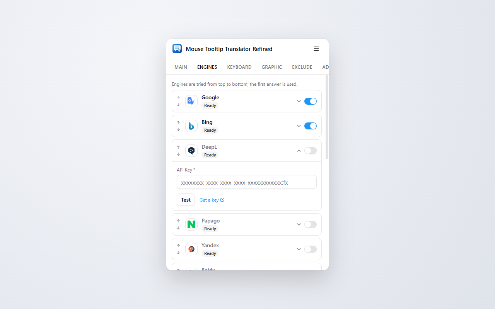

# Mouse Tooltip Translator Refined

Hover or select text on any page to see its translation in a tooltip.

> An independent fork of [Mouse Tooltip Translator](https://github.com/ttop32/MouseTooltipTranslator) by ttop32, rewritten from scratch with WXT, Svelte 5 and TypeScript. It is not affiliated with or endorsed by the original project.


## Features

- Translate a word, sentence or paragraph on hover, or whatever you select
- Translate what you type in a text field (Right Alt)
- Translate the whole page with a shortcut
- Built-in PDF viewer and ebook reader (EPUB, MOBI, FB2, CBZ) with the same tooltips
- An ordered list of engines with automatic fallback: Google, Bing, DeepL, Papago, Yandex, Baidu, the browser's built-in translator, Kakao i, LibreTranslate, or any OpenAI-compatible LLM. Add your own DeepL, Papago (Naver Cloud), Google Cloud or Microsoft Translator API key to use the official API
- Translations are cached for 30 days, so the same text isn't sent again
- Per-site target language, site and language exclusions, settings sync

| Settings | Engines | PDF viewer |
| --- | --- | --- |
|  |  |  |

## Usage

| Action | Default |
| --- | --- |
| Translate | Hover or select text |
| Translate the text you're typing | <kbd>Right Alt</kbd> |
| Translate the page | Off (set a key in Settings → Keyboard) |
| Copy translated / source text | <kbd>Ctrl</kbd>+<kbd>Shift</kbd>+<kbd>6</kbd> / <kbd>7</kbd> |
| Translate from the address bar | Type `/`, a space, then your text |

See [docs/intro.md](docs/intro.md) for details.

## Development

Requires Node 22.18+ and pnpm.

```sh
pnpm install
pnpm dev              # Chrome with the extension loaded, auto-reload
pnpm build            # .output/chrome-mv3
pnpm build:firefox    # .output/firefox-mv2
pnpm test             # unit tests
pnpm test:e2e         # end-to-end tests (headless Chromium)
pnpm screenshots      # regenerate docs/screenshots
```

Load `.output/chrome-mv3` from `chrome://extensions` with Developer mode on.

## Credits

Forked from [Mouse Tooltip Translator](https://github.com/ttop32/MouseTooltipTranslator) by ttop32 and its contributors, under the MIT license. Thanks to them for the original extension and its translations.

## License

[MIT](LICENSE)
