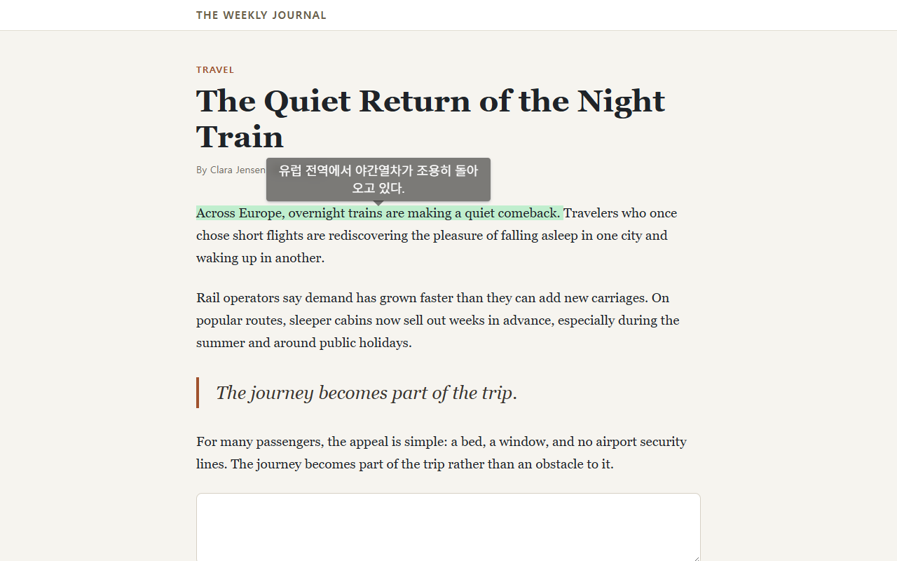
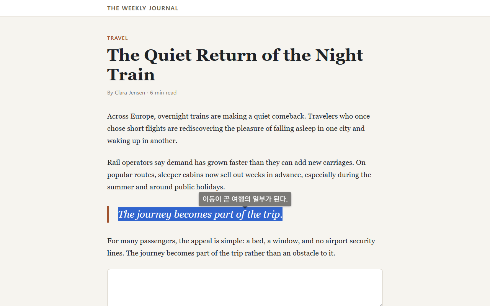
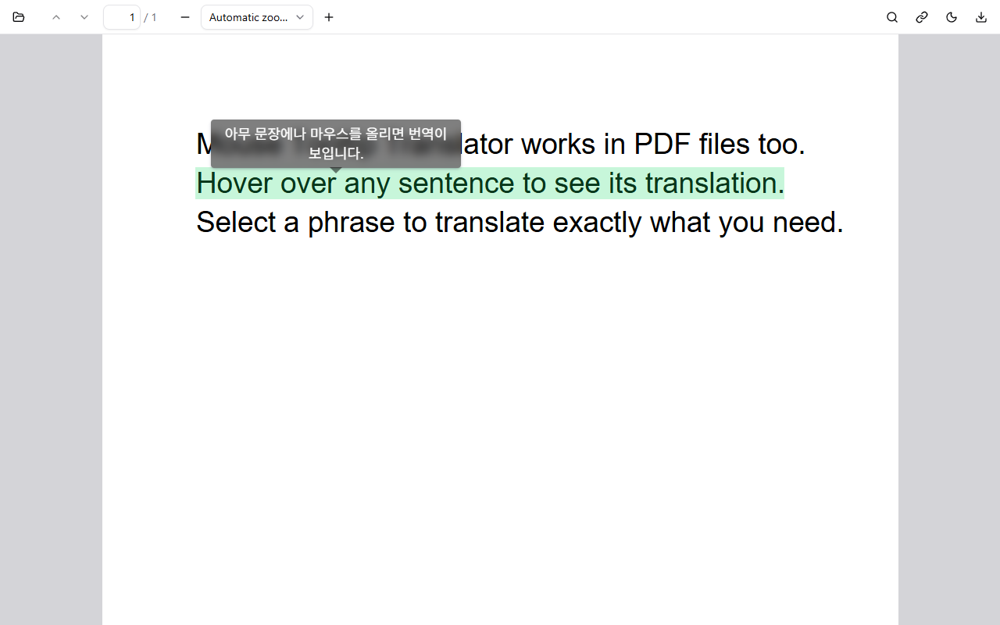
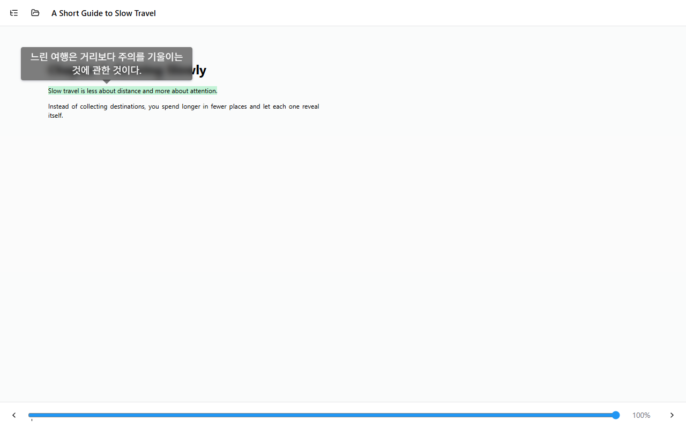

# Getting started

Point at any text to translate it. Try it on this sentence:

> Proletarier aller Länder, vereinigt euch!

Nothing shows up? Check the target language in the extension's settings. Text that is already in your target language is skipped.

## Select

Select a word or a phrase to translate exactly that.

## Typing

Press <kbd>Right Alt</kbd> in a text field to replace what you typed with its translation (into the *Writing language*). <kbd>Ctrl</kbd>+<kbd>Z</kbd> undoes it. If Right Alt switches your keyboard layout, pick another key under Settings → Keyboard.

## Address bar

Type `/`, a space and your text in the address bar. It is translated and searched with your default search engine.

## PDF and ebooks

Web PDFs open in the built-in viewer, so the tooltip works there too. You can turn this off with *Detect PDF* under Settings → Advanced.

Local PDF files need file access: open the extension's details page and turn on *Allow access to file URLs*. You can also drag a file onto the viewer.

Ebooks (EPUB, MOBI, FB2, CBZ) open in the reader from the menu in the settings window.

## Shortcuts

Keys are set under Settings → Keyboard. Browser-level shortcuts, like copying the last translation (<kbd>Ctrl</kbd>+<kbd>Shift</kbd>+<kbd>6</kbd>), are changed at `chrome://extensions/shortcuts`.

## Known limits

- The page needs focus for key shortcuts to work. Click the page first.
- Browser pages like `chrome://` and the extension stores can't be translated.
- Text in the browser's own PDF viewer can't be read; use the built-in viewer.
